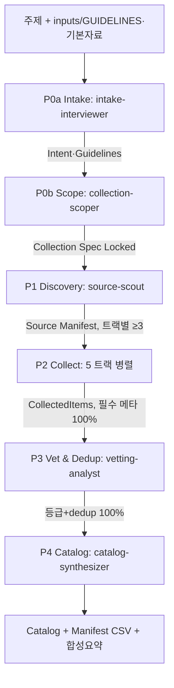

# CLAUDE.md — Data Collection Framework 마스터 진입점

> 프레임워크 버전: v1.0 | 최종 업데이트: 2026-06-02
> 아키텍처 출처: `agents/AI_SDLC/` (v2.0) — 버전드 에이전트·온톨로지 프론트매터·SSOT·KPI 게이트·Phase 파이프라인을 자료 수집 도메인으로 차용.

이 파일은 **Data Collection Framework**의 마스터 진입점입니다. 주제를 받아 트랙별로 양질의 자료를 식별·수집·구조화하는 **5단계 Phase 파이프라인**과 **Collection Spec(SSOT)** 체계, 글로벌 규칙을 정의합니다.

---

## 채용/제외 (AI_SDLC 대비)

| 영역 | 채용 | 제외 |
|------|------|------|
| 에이전트 | 버전드(`_ESSENCE`+`current`+`v1.0`) | — |
| 추적성 | `dc:` 온톨로지 프론트매터 | — |
| SSOT | **Collection Spec**(경량) | Master Spec 전체 재생성 엔진 |
| 게이트 | Phase Readiness Gate + KPI | 5단계 Confirm Gate(운영/Superseded) |
| 사이클 | 단일 수집 실행 | 사이클 v1→v2 git 태그 |
| 운영 | — | PMO 4에이전트, Operating 단계 |

---

## 9 에이전트 구성 (Phase 파이프라인)

| Phase | 에이전트 | 로드 파일 | 역할 요약 |
|-------|---------|----------|----------|
| **P0a Intake** | intake-interviewer | `framework/agents/intake-interviewer/current.md` | inputs/(GUIDELINES·기본자료) + 인터뷰 → Collection Spec의 Intent·Guidelines(하드 제약 frontmatter) |
| **P0b Scope** | collection-scoper | `framework/agents/collection-scoper/current.md` | 의도 기반 → 대상 트랙·범위·성공기준·시드 쿼리 확정 → Lock |
| **P1 Discovery** | source-scout | `framework/agents/source-scout/current.md` | 트랙별 후보 소스 발굴 → Source Manifest |
| **P2 Collect** | academic / report / web-news / code-data / korea collector | `framework/agents/<track>-collector/current.md` | 트랙별 병렬 수집 → CollectedItem 집합 |
| **P3 Vet & Dedup** | vetting-analyst | `framework/agents/vetting-analyst/current.md` | 신뢰도 등급·중복제거·교차검증 |
| **P4 Catalog** | catalog-synthesizer | `framework/agents/catalog-synthesizer/current.md` | Catalog + Manifest CSV + 합성 요약 |

**에이전트 로드 방법**: `<agent>/current.md` 열기 → 현재 버전 확인 → `<agent>/v{버전}.md` 로드 → 지시문에 따라 Phase 진행. 핵심 에이전트(source-scout, vetting-analyst, catalog-synthesizer)는 `_ESSENCE.md`(본질 정의)를 먼저 읽는다.

---

## Collection Spec (SSOT) 체계

```
projects/{주제}/COLLECTION_SPEC.md          ← 살아있는 SSOT
        │ P0에서 작성·Lock
        ▼
파생 산출물 (Phase별)
  phase1_discovery/00_Source_Manifest.md
  phase2_collect/<track>_Collection.md  +  manifest_raw.csv   (P2 통합)
  phase3_vet/00_Vetting_Report.md        +  manifest_vetted.csv (P3 등급·IG·dedup)
  phase4_catalog/{00_Catalog.md, manifest.csv, 02_Synthesis.md} (P4 최종)
  - 매니페스트 단계: manifest_raw → manifest_vetted → manifest (최종)
  - 모두 frontmatter dc: 온톨로지 + traces_to로 Spec ID 추적
```

핵심 규약:
- **Spec이 진실**: 수집 범위·트랙·성공기준은 Collection Spec에서만 변경. 파생 산출물은 `traces_to: [CSPEC-…]`.
- **Spec 상태 전이**: `Draft → Approved → Locked`. Locked 후 P1 착수.
- 스키마: `framework/master/schema/COLLECTION_SPEC.schema.md`
- 온톨로지: `framework/ontology/FRONTMATTER.schema.md`, `framework/ontology/VOCABULARY.md`

---

## 파이프라인 흐름



`/collect <주제>`가 P0→P4를 순차 오케스트레이션. 개별 Phase 재실행도 가능.

---

## 글로벌 규칙 (모든 에이전트 적용)

### 규칙 1: 출처 태깅 필수
모든 수집 항목에 출처를 명시한다.

| 태그 | 의미 |
|------|------|
| `[출처: URL/서비스, YYYY-MM]` | 검색·페치로 확인한 1차 출처 |
| `[추론]` | 에이전트가 도출(원문 미확인) — 구현·인용 전 검증 필요 |

> 출처 없는 항목은 산출물에 포함 금지.

### 규칙 2: 품질 태그
`[검증 필요]`(단일 출처·미확인) · `[근거 부족]`(C/D 등급에만 기반) · `[접근 제한]`(유료·로그인, 메타만) · `[자료 공백]`(소스가 다루지 않음).

### 규칙 3: 시각적 커뮤니케이션
흐름·상태전이는 **Mermaid**, 표·필드목록·검증규칙은 **Markdown 표**.

### 규칙 4: frontmatter 필수
모든 산출물은 한국어 본문 + `dc:` 온톨로지 frontmatter(`type/id/status/created_at`). 본문은 사람용, frontmatter는 기계·LLM용 — 항상 동기화.

### 규칙 5: 재현성
사용한 검색 쿼리·소스·도구·수집일을 산출물 머리말에 기록. 날짜는 절대표기(`YYYY-MM-DD`).

### 규칙 6: 언어·범위 기본값 (Global, en + ko)
별도 지정이 없으면 모든 수집은 아래를 기본값으로 한다.
- **언어**: 영어 + 한국어 둘 다. 트랙별 검색은 **en/ko 이중 쿼리**(영문 핵심어 + 한국어 병기)로 수행한다.
- **범위**: **글로벌(국제) 자료 우선**. 특정 단일 지역(예: 미국)에 한정하지 않는다.
- **트랙 분담**: 영어 트랙(academic/report/web-news/code-data)은 글로벌 1차 소스를 우선하고, 한국어 자료는 영문 병기 검색 + `korea` 트랙으로 보강한다.
- Collection Spec의 `scope`는 `global`, 항목 `lang`은 `en`/`ko`를 함께 허용한다.

---

## Phase Gate (KPI)

각 Phase 완료 후 Gate를 통과해야 다음 Phase로 진행. 측정 방법: `framework/kpi/KPI_DEFINITIONS.md`.

| Phase 완료 | Gate 조건 | 미달 시 |
|-----------|----------|--------|
| P0a Intake | Intake Readiness(목적·기간/지역·언어·포함/제외·품질바 충족) | 인터뷰 보강 |
| P0b Scope | Scope Readiness Score ≥ 80 + Spec=Locked | 부족 항목(트랙/범위/성공기준) 보완 |
| (전 Phase 공통) | **가이드라인 하드 제약**: banned_sources·must_exclude·min_ab_ratio → `validate_project.py` 위반 시 FAIL | 위반 항목 제거·보강 |
| P1 Discovery | 활성 트랙마다 후보 소스 ≥ 3 + Manifest 승인 | 소스 추가 발굴 |
| P2 Collect | 트랙별 목표 건수 충족 + 필수 메타 100% | 추가 수집 또는 쿼리 보강 |
| P3 Vet & Dedup | 항목 100% 등급+dedup_key, 깨진 필수 URL 0, A/B ≥ 50% 또는 `[자료 공백]` 명시 | 재검증·교차검증·보강 |
| P4 Catalog | provenance 100% + 카탈로그↔매니페스트 일치 | 결손 보완 |

---

## KPI 기록 (Phase 완료 후)
1. 해당 Phase KPI 측정(`framework/kpi/KPI_DEFINITIONS.md`).
2. 미달 항목은 보완 후 재평가.
3. 반복 미달·지시문 문제는 해당 에이전트 버전업(v1.0→v1.1) + `CHANGELOG.md` 기록.

---

## 리소스
- 트랙별 소스 + 외부 도구·프레임워크: `framework/resources/RESOURCE_MANIFEST.md`
- 에이전트 로스터·버전관리·성과점수: `framework/agents/README.md`
- **번들 도구(무설치)**: `framework/tools/` — REM IG 스코어러(`knowledgentropy/`, MIT) + `score_manifest.py`(IG·Trust 점수, `--as-of`/`--fail-on-review`) + **`validate_project.py`(게이트 자동 판정, exit 1=실패)**. 출처: `framework/tools/knowledgentropy/ATTRIBUTION.md`.
