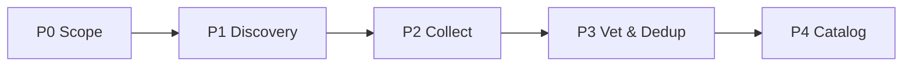

# Data Collection Framework

주제를 받아 **트랙별로 양질의 자료를 식별 → 수집 → 출처·신뢰도 메타데이터와 함께 구조화**하는 자료 수집 프레임워크입니다. 옆 폴더 `agents/AI_SDLC/`의 아키텍처(버전드 에이전트·온톨로지 프론트매터·SSOT·KPI 게이트·Phase 파이프라인)를 자료 수집 도메인으로 차용했습니다.

진입점·글로벌 규칙·게이트는 [CLAUDE.md](CLAUDE.md)를 보세요.

## 5단계 Phase 파이프라인



| Phase | 에이전트 | 산출물 |
|-------|---------|--------|
| P0a Intake | [intake-interviewer](framework/agents/intake-interviewer/current.md) | Intent·Guidelines (inputs/ + 인터뷰 → SSOT 초안) |
| P0b Scope | [collection-scoper](framework/agents/collection-scoper/current.md) | Collection Spec(SSOT) Lock |
| P1 Discovery | [source-scout](framework/agents/source-scout/current.md) | Source Manifest |
| P2 Collect | [academic](framework/agents/academic-collector/current.md) · [report](framework/agents/report-collector/current.md) · [web-news](framework/agents/web-news-collector/current.md) · [code-data](framework/agents/code-data-collector/current.md) · [korea](framework/agents/korea-collector/current.md) | CollectedItem 집합 |
| P3 Vet & Dedup | [vetting-analyst](framework/agents/vetting-analyst/current.md) | Vetting Report(등급·중복) |
| P4 Catalog | [catalog-synthesizer](framework/agents/catalog-synthesizer/current.md) | Catalog + Manifest CSV + 합성 요약 |

## 5개 수집 트랙 (P2)

| 트랙 | 대상 | 1차 소스 |
|---|---|---|
| academic | 논문·프리프린트 | arXiv, OpenAlex, Semantic Scholar, Crossref, PubMed |
| report | 기관·정책·컨설팅 보고서 | 정부/국제기구/싱크탱크/컨설팅 PDF |
| web-news | 웹·뉴스·블로그 | WebSearch, 뉴스, 기술 블로그 |
| code-data | 코드·데이터셋·벤치마크 | GitHub, Hugging Face, Kaggle, Papers with Code |
| korea | 국내 한국어 자료 | RISS, DBpia, KCI, ScienceON, 공공데이터포털 |

도구·소스 상세: [framework/resources/RESOURCE_MANIFEST.md](framework/resources/RESOURCE_MANIFEST.md) — 내장 `WebSearch`/`WebFetch`로 즉시 동작, 외부 도구는 선택 설치.

## 빠른 시작

```text
1. P0: collection-scoper로 주제 스코핑 → projects/<주제>/COLLECTION_SPEC.md 작성·Lock
2. P1: source-scout로 트랙별 소스 발굴
3. P2: 5개 트랙 수집가 병렬 실행
4. P3: vetting-analyst로 신뢰도 등급·중복제거
5. P4: catalog-synthesizer로 카탈로그·매니페스트·요약 생성
```

산출물은 `projects/<주제>/phaseN_*/`에 Phase별로 저장됩니다. 시작점 템플릿: [projects/_TEMPLATE/](projects/_TEMPLATE/).

## 핵심 개념
- **Collection Spec (SSOT)**: 수집 범위·트랙·성공기준의 단일 진실. 파생물은 이를 `traces_to`로 추적.
- **dc: 온톨로지**: 모든 산출물 frontmatter가 `type/id/status` + 관계(`anchored_on/traces_to`)를 가져 추적·검증 가능. [framework/ontology/](framework/ontology/).
- **Phase Gate**: 각 단계 Readiness/조건 미달 시 다음 단계 차단. [framework/kpi/KPI_DEFINITIONS.md](framework/kpi/KPI_DEFINITIONS.md).
- **출처·신뢰도 규율**: 출처 없는 항목 금지, A/B/C/D 등급, 품질 태그.
